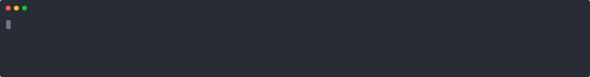

# agline

A zero-dependency, single-line statusline HUD for **Google Antigravity CLI** (`agy`).
One Node.js ESM file — no `npm install`, no build step. Node 18+ is enough.

Inspired by agy-hud (MIT) by AllenMuu — rewritten from scratch for Antigravity CLI 1.4.3's statusline protocol.



<sub>Synthesized asciinema replay (`docs/demo.cast` → `docs/demo.svg` via svg-term-cli) of real `agline.mjs` output frames — not a screen recording.</sub>

## What it shows

```
[Gemini 4 Argon (High)] │ veyra git:(main*) │ Context ▰▰▰░░░░░░░ 30% │ ETA 2h 10m │ 5h ▰▰▰▰▰▱ 77% · 2h 15m · Wk ▰▱▱▱▱▱ 10% · 3d 4h │ ★ 12d
```

- **Spinner** (`◐ ◓ ◑ ◒`) while the agent is active
- **Model badge** (bold bright cyan)
- **Workspace + git** branch, dirty `*`, `[⇅]` when local/`origin` hashes differ (pure filesystem reads, no `git` process; the compared remote is always `origin`). Works in linked worktrees via `commondir` resolution.
- **Context** bar from `context_window.used_percentage` (green → yellow at `contextWarning` → red at `contextCritical`, plus `⚠ /compact` at critical)
- **ETA** to context exhaustion from a rolling burn-rate (`~/.config/agline/burn-state.json`)
- **Quota** 5h / weekly buckets with reset countdowns (gemini vs 3p chosen from the model name)
- **Streak** of *consecutive* usage days in your local timezone (`~/.config/agline/stats.json`) + milestone trophies at 7/30/100/365 days

Segments drop progressively (streak → ETA → weekly quota → countdowns → `…` truncation) to fit the terminal width. ANSI-aware: never cuts inside an escape sequence. Respects `NO_COLOR`.

## Install

```sh
npx @sqwlly/agline install
```

(Straight from npm — no clone needed. The GitHub form `npx github:sqwlly/agline install` also works.)

npx is only the delivery mechanism: the installer copies `agline.mjs` to a stable location,
`~/.local/share/agline/agline.mjs`, and points the statusLine at that path — so every render
runs plain `node` on a local file (~40 ms), independent of the npx cache.

This creates `~/.config/agline/config.json` (from built-in defaults, if missing), copies
`agline.mjs` to `~/.local/share/agline/`, and patches
`~/.gemini/antigravity-cli/settings.json` → `statusLine` to:

```json
{ "type": "command", "command": "node ~/.local/share/agline/agline.mjs", "enabled": true }
```

(with the actual home path expanded).

All other settings are preserved (JSON round-trip, indent 2). Before overwriting, the current
`settings.json` is copied to `settings.json.bak` (an existing `.bak` is kept — the oldest backup
wins). The installer also prints the previous `statusLine` value as a rollback command, refuses
to touch a `settings.json` that is not a JSON object, and is idempotent on re-run.

## Uninstall

```sh
npx @sqwlly/agline uninstall
```

If agline's statusLine is active, this restores `settings.json.bak` when present (otherwise
deletes just the `statusLine` key), then removes `~/.local/share/agline`. If the statusLine
points at something else, it refuses and prints the current value. Your config in
`~/.config/agline/` is kept; delete it manually if unwanted.

## Config

`~/.config/agline/config.json` (all keys optional, defaults shown):

```json
{
  "barWidth": 10,
  "quotaBarWidth": 6,
  "maxWidth": null,
  "contextWarning": 70,
  "contextCritical": 85,
  "showStreak": true,
  "showEta": true,
  "showQuota": true,
  "showGit": true
}
```

- `barWidth` / `quotaBarWidth` — cells in the context / quota bars (`▰`/`▱`)
- `maxWidth` — hard cap for the rendered line; `null` uses `terminal_width` from the payload (fallback 80), minus 2, floor 40
- `contextWarning` / `contextCritical` — percent thresholds for yellow / red (and `⚠ /compact`)
- `showStreak` / `showEta` / `showQuota` / `showGit` — segment toggles

## Files

| Path | Purpose |
| --- | --- |
| `agline.mjs` | the entire statusline + CLI (`node agline.mjs [install\|uninstall\|--version\|--help]`) |
| `config.example.json` | documented defaults (reference only; the installer embeds them) |
| `~/.config/agline/config.json` | runtime config (not in repo) |
| `~/.config/agline/burn-state.json` | ETA burn-rate samples (runtime) |
| `~/.config/agline/stats.json` | usage-day streak (runtime) |
